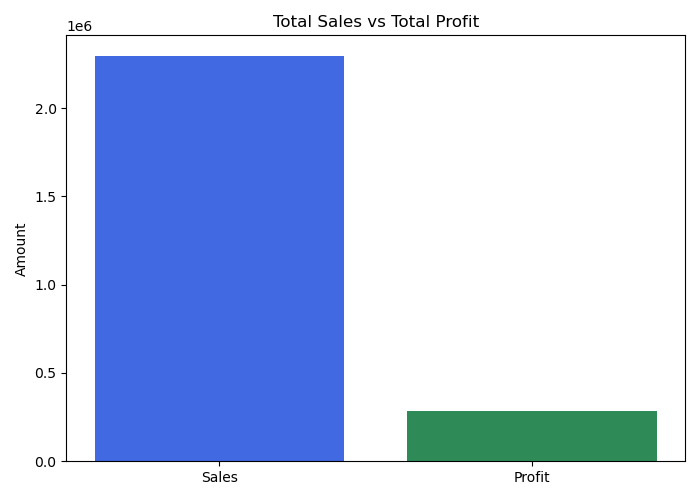
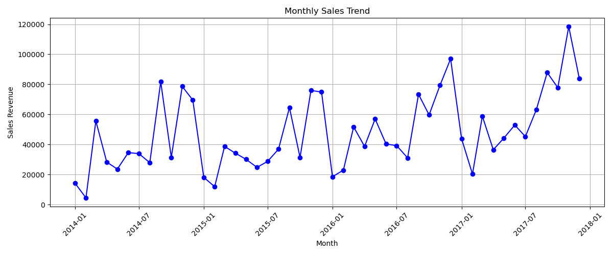
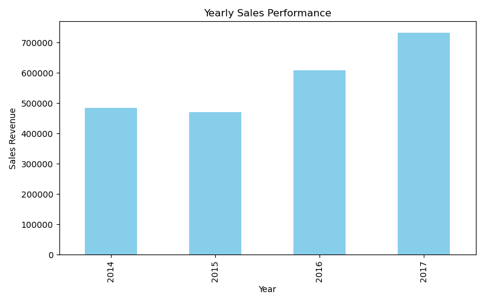
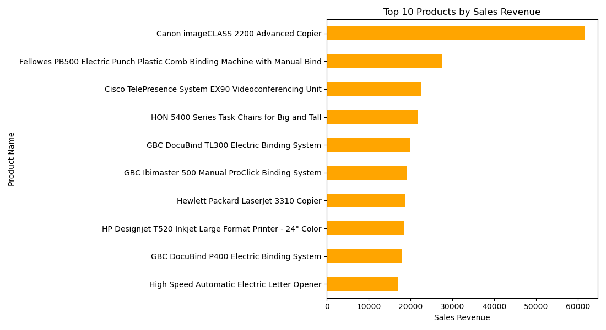
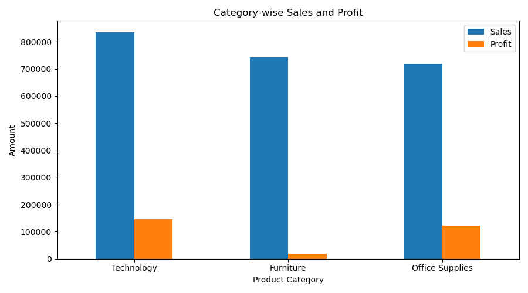
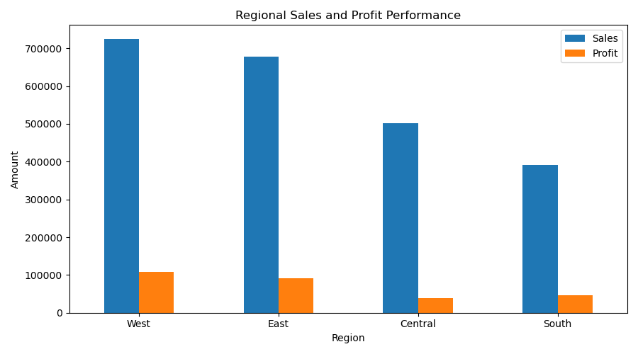

# Business Sales Performance Analytics

## Project Overview

This project focuses on analyzing business sales data using Python to understand revenue trends, profitability, product performance, and regional sales distribution.

The objective is to extract meaningful insights from retail sales data and provide actionable recommendations for improving business performance.

## Tools and Technologies

- Python
- Pandas
- NumPy
- Matplotlib
- Seaborn
- Jupyter Notebook
- GitHub

## Dataset

**Dataset Name:** Sample Superstore Sales Dataset

The dataset contains retail sales information, including order dates, product names, sales, profit, quantity, categories, and regions.

## Project Objectives

1. Analyze total sales revenue and profit.
2. Identify monthly and yearly sales trends.
3. Find the top 10 products by sales revenue.
4. Analyze high-revenue product categories.
5. Compare regional sales performance.
6. Generate actionable business recommendations.

## Data Cleaning

- Checked missing values.
- Identified and removed duplicate records.
- Converted order dates into datetime format.
- Extracted year and month for trend analysis.
- Prepared cleaned data for analysis.

## Exploratory Data Analysis

### 1. Total Sales and Profit
Calculated total revenue, total profit, order count, quantity sold, and profit margin.

### 2. Monthly and Yearly Sales Trends
Analyzed sales performance across months and years to understand business growth patterns.

### 3. Top 10 Selling Products
Identified the top 10 products based on total sales revenue.

### 4. Category-wise Performance
Compared revenue and profit across different product categories.

### 5. Regional Sales Analysis
Analyzed sales and profitability across business regions.

### 6. Business Recommendations
Developed recommendations based on product, category, and regional sales performance.

## Project Visualizations

### Total Sales vs Profit

### Monthly Sales Trend

### Yearly Sales Trend

### Top 10 Products

### Category-wise Sales

### Regional Sales

## Business Insights

This project examines:
- Revenue and profitability trends.
- Product-level sales performance.
- Category-level revenue contributions.
- Regional differences in sales and profit.

Specific findings and numerical results can be added after reviewing the analysis output.

## Business Recommendations

- Investigate growth opportunities in high-performing regions.
- Review low-profit regions to identify possible improvement areas.
- Evaluate inventory planning for high-demand products.
- Analyze category profitability before increasing marketing investment.

## Project Files

- `analysis.ipynb` – Jupyter Notebook analysis
- `sales_analysis.py` – Python analysis script
- `cleaned_sales.csv` – Cleaned sales dataset
- `charts/` – Sales performance visualizations

## How to Run

Install the required Python libraries:

`pip install pandas numpy matplotlib seaborn openpyxl`

Run the Python analysis:

`python sales_analysis.py`

Ensure the dataset is available at the path expected by the script.

## Skills Demonstrated

Python | Pandas | Data Cleaning | Exploratory Data Analysis | Data Visualization | Business Analytics | KPI Analysis

## Project Status

Completed – Initial sales analysis and visualizations.
